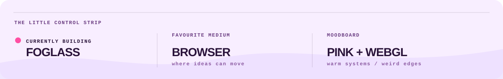

  

<a href="https://github.com/krithi-1304/FOGLASS">FOGLASS</a>　 <a href="https://github.com/krithi-1304/Glowmory">GLOWMORY</a>　 <a href="https://github.com/krithi-1304/STICKY_WALL_WORLD">THE BLACK WALL</a>　 <a href="https://github.com/krithi-1304?tab=repositories">ALL WORK</a>

 

 

## I make software feel like a place.

I’m Krithi — a creative developer building browser experiences where camera input, microphones, WebGL, encryption, and tiny human details meet.

My favourite kind of interface is technically clever, visually warm, and just a little unexpected.

 

 

## the contribution garden

Not a green spreadsheet. A living little signal of what I’ve been making.

pink pixels · real activity · refreshed daily

 

<table><tr><td width="50%" valign="top">

### currently curious about

`creative coding` `local-first software` `human interfaces` `privacy as a feeling`

</td><td width="50%" valign="top">

### my toolkit

`TypeScript` · `React` · `WebGL` `Node.js` · `Python` · `Playwright`

</td></tr></table>

 

<a href="https://www.linkedin.com/in/krithi-1304/">LINKEDIN</a>　 <a href="https://github.com/krithi-1304">GITHUB</a>  made with pink pixels, clean code, and too many tabs open

