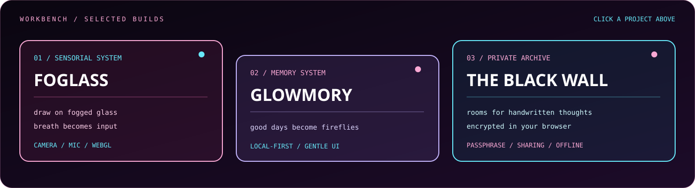
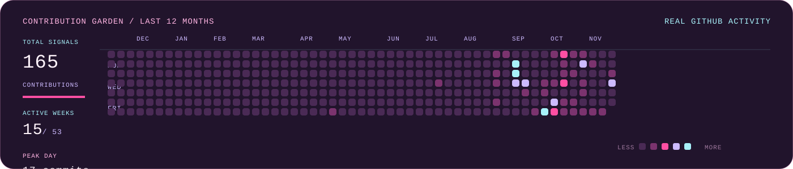

 

<a href="https://github.com/krithi-1304/FOGLASS">FOGLASS</a>　•　<a href="https://github.com/krithi-1304/Glowmory">GLOWMORY</a>　•　<a href="https://github.com/krithi-1304/STICKY_WALL_WORLD">BLACK WALL</a>　•　<a href="https://github.com/krithi-1304?tab=repositories">ALL REPOS</a>

 

 

## `krithi.exe` / developer + dreamer

I build playful interfaces with serious systems underneath: camera input, microphone interaction, WebGL, browser encryption, offline-first flows, and lots of tiny details.

I like technology that feels **expressive, personal, and a little magical**.

### `now_loading`

**FOGLASS** — a browser mirror you can draw on. Point to draw, open your palm to wipe, breathe to bring the steam back.

<a href="https://krithi-1304.github.io/FOGLASS/">LAUNCH LIVE BUILD ↗</a>　 <a href="https://github.com/krithi-1304/FOGLASS">READ THE SOURCE ↗</a>

  

## `contribution_control_room`

real GitHub activity · refreshed daily · pink pixels instead of default green

 

## `stack / signal / intent`

<table>
<tr>
<td width="33%" valign="top">

### `01` / STACK

`TypeScript` 
`React` 
`WebGL` 
`Node.js` 
`Python` 
`Playwright`

</td>
<td width="33%" valign="top">

### `02` / SIGNAL

✦ local-first 
✦ privacy-minded 
✦ expressive UI 
✦ browser-native 
✦ shipping experiments

</td>
<td width="33%" valign="top">

### `03` / INTENT

Make it tangible. 
Keep it local. 
Make it feel good. 
Ship the feeling.

</td>
</tr>
</table>

<b>open the lab notes</b>

 

I’m exploring how browser software can feel physical without pretending to be a native app; how privacy can be visible in the interface; and how technical work can stay warm, weird, and human.

 

<a href="https://github.com/krithi-1304">GITHUB</a>　•　<a href="https://www.linkedin.com/in/krithi-1304/">LINKEDIN</a>

  

built with pink pixels, clean code, and too many tabs open

